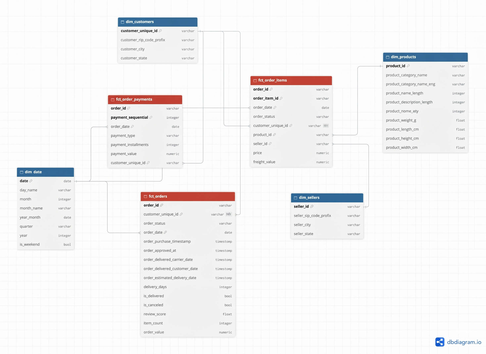

# Olist-analytics Project
---
_End-to-end analytics engineering project: raw Olist e-commerce data → BigQuery → dbt → Power BI._

     

---


## 1. Business Problem
---
### **Company & Business Model**

- **Olist:** A B2B2C e-commerce enabler platform in Brazil that empowers small and medium-sized businesses (SMBs) to list and sell their products across major Brazilian marketplaces (such as Mercado Livre, Americanas, and Amazon) under a unified Olist storefront brand.
	
- **Revenue Mechanism**: Generates revenue through a take-rate commission on Gross Merchandise Value (GMV), complemented by a fixed monthly subscription fee per active seller.

### **Business Questions**

To evaluate marketplace performance and revenue generation using the Olist dataset, the analytics workflow focuses on the following metric-driven questions:

#### **# Revenue & Order Scale**

- **Q1. Monthly GMV Trend:** How do total Monthly GMV and Completed Orders Volume change over time, and in which specific months do they peak?
    
- **Q2. Average Order Value:** What is the monthly trend of Average Order Value (AOV), and how does order value vary across different price tiers?

#### **# Category Performance**

- **Q3. Top Revenue Categories:** What are the Top 10 Product Categories by Revenue, and what exact percentage does each category contribute to the total Revenue?

#### **# Operational Efficiency & Logistics**

- **Q4. Delivery Lead Time:** What is the Average Delivery Lead Time (in days) from order approved to customer delivery, and how does it vary by state?
    
- **Q5. On-time Delivery Rate:** What is the monthly On-time Delivery Rate (percentage of orders delivered on and before the estimated delivery date), and among late orders, how many days late are they on average?

#### **# Order Risk & Reliability**

- **Q6. Order Cancellation Rate:** What is the monthly order cancellation rate, and which product categories have the highest cancellation rate (categories with at least N orders)?

#### **# Customer Satisfaction**

- **Q7. Review Score Distribution:** What is the average review score per month, and what exact percentage of total orders fall into each rating tier (from 1 to 5 stars)?


## 2. Key insights
---

*Coming in next phases*
*(đây là phần làm nổi bật tư duy phân tích dữ liệu)*


## 3. Architecture
---

*Coming in next phases:*
- [ ] *Sơ đồ luồng dữ liệu: Kaggle CSV → load script → BigQuery `raw` → dbt (staging → intermediate → marts) → Power BI*
- [ ] *Bảng tech stack: tool | dùng để làm gì*


## 4. Data Model



The warehouse follows a **galaxy schema**: three fact tables at different grains share conformed dimensions (`dim_customers`, `dim_products`, `dim_sellers`, `dim_date`).

- `fct_orders`: one row per order (status, delivery, review)
- `fct_order_items`: one row per item in an order (price, freight)
- `fct_order_payments`: one row per payment of an order

Keeping each fact at its natural grain avoids double-counting when an order has multiple items or payments.

*💡 **Detailed Documentation:** For a comprehensive breakdown of the schema design, table relationships, and field dictionaries, please refer to the [Data Model Documentation](docs/data_model.md).*


## 5. dbt Project
---

*Coming in next phases*


## 6. Repository structure
---

```
olist-analytics/                  <-- Root workspace
├── .git/                         <-- Git management
├── .venv/                        <-- Python virtual environment
├── .gitignore                    <-- Files/folders to ignore
├── README.md                     <-- 📌 README (shows in the Github homepage)
├── docs/                         <-- Contains design documents & Schema diagrams
└── olist_analytics/              <-- The folder containing dbt project
    ├── dbt_project.yml           <-- Overall dbt configuration
    ├── models/                   
    │   ├── staging/              
    │   │   ├── stg_customers.sql 
    │   │   └── schema.yml        <-- 📌 dbt schema.yml files are located here
    │   └── marts/                
    ├── analyses/
    ├── tests/
    └── macros/
```


## 7. How to run
---

*Coming in next phases*
*(người khác làm theo phải chạy được dự án)*


## 8. What I learned / Next steps
---

*Coming in next phases*


## 9. Contact
---

*Add LinkedIn & Email*

