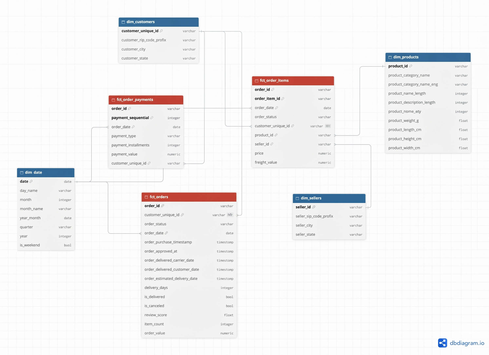

# Data Model
---
**A galaxy schema**: three fact tables at different grains (`fct_orders`, `fct_order_items`, `fct_order_payments`) share conformed dimensions (`dim_customers`, `dim_products`, `dim_sellers`, `dim_date`).

## 1. Overview
---

| Table                | Type (fact/dim) | Grain                                               | Primary Key                       | Source                                                                             |
| -------------------- | --------------- | --------------------------------------------------- | --------------------------------- | ---------------------------------------------------------------------------------- |
| `fct_orders`         | fact            | one unique order                                    | `order_id`                        | `olist_orders_dataset`, `olist_order_reviews_dataset`, `olist_order_items_dataset` |
| `fct_order_items`    | fact            | one unique item in one unique order                 | `order_id` + `order_item_id`      | `olist_orders_dataset`, `olist_order_items_dataset`                                |
| `fct_order_payments` | fact            | one payment installment for one order               | `order_id` + `payment_sequential` | `olist_order_payments_dataset`                                                     |
| `dim_customers`      | dim             | one unique customer                                 | `customer_unique_id`              | `olist_customers_dataset`                                                          |
| `dim_sellers`        | dim             | one unique seller                                   | `seller_id`                       | `olist_sellers_dataset`                                                            |
| `dim_products`       | dim             | one unique product                                  | `product_id`                      | `olist_products_dataset`, `product_category_name_translation`                      |
| `dim_date`           | dim             | one calendar day, from `2016-01-01` to `2018-12-31` | `date`                            | *add externally*                                                                   |

## 2. Entity Relationship Diagram (ERD)
---

### **Fact Tables**
---
#### `fct_orders`: record sales history.
	
- Grain: Each line represents **1 unique order**.
- Primary key: `order_id`.
- Measures: `delivery_days`, `review_score`, `item_count`, `order_value`.
- Foreign key: `customer_unique_id`, `order_date`.
- Source: `olist_orders_dataset`, `olist_order_reviews_dataset`, `olist_order_items_dataset`.

	*Derived Columns:*

| Column          | Type      | Logic                                                                                       | Source columns                                                        |
| --------------- | --------- | ------------------------------------------------------------------------------------------- | --------------------------------------------------------------------- |
| `delivery_days` | `integer` | `DATE_DIFF(order_delivered_customer_date, order_approved_at, DAY)`, `NULL` if not delivered | the two timestamp columns in `olist_orders_dataset`                   |
| `item_count`    | `integer` | `COUNT(order_item_id)`, within the same `order_id`                                          | `order_item_id` column in `olist_order_items_dataset`                 |
| `order_value`   | `numeric` | `SUM(price + freight_value)` of all the items with the same `order_id`                      | two column `price` and `freight_value` in `olist_order_items_dataset` |
| `review_score`  | `integer` | `AVG(review_score)`                                                                         | `review_score` column in `olist_order_reviews_dataset`                |
| `is_delivered`  | `boolean` | TRUE if `order_status` is 'delivered' else FALSE                                            | `order_status` column in `olist_orders_dataset`                       |
| `is_canceled`   | `boolean` | TRUE if `order_status` is 'canceled' else FALSE                                             | `order_status` column in `olist_orders_dataset`                       |

#### `fct_order_items`: record order details.
	
- Grain: Each line represents **1 unique item in one unique order**.
- Primary key: (`order_id` + `order_item_id`).
- Measures: `price`, `freight_value`.
- Foreign key: `customer_unique_id`, `seller_id`, `product_id`, `order_date`.
- Source: `olist_orders_dataset`, `olist_order_items_dataset`.

#### `fct_order_payments`: record payment transactions.
	
- Grain: Each line represents **1 payment installment for one unique order**.
- Primary key: (`order_id` + `payment_sequential`).
- Measures: `payment_installments`, `payment_value`.
- Foreign key: `customer_unique_id`, `order_date`.
- Source: `olist_order_payments_dataset`.

### **Dimension Tables**
---
#### `dim_customers`: customer list and customer information.
	
- Grain: Each line represents **1 unique customer**.
- Primary key: `customer_unique_id`.
- Source: `olist_customers_dataset`.

#### `dim_products`: product list and product information.
	
- Grain: Each line represents **1 unique product**.
- Primary key: `product_id`.
- Source: `olist_products_dataset`, `product_category_name_translation`.

#### `dim_sellers`: seller list and seller information.
	
- Grain: Each line represents **1 unique seller**.
- Primary key: `seller_id`.
- Source: `olist_sellers_dataset`.

#### `dim_date`: contains information about the date.
	
- Grain: Each line represents **1 calendar date from `2016-01-01` to `2018-12-31`**.
- Primary key: `date`.
- Source: *add externally*.

## 3. Business Questions & KPIs
---
### KPI definitions

- **Monthly GMV (Q1):** The total value of goods (`order_value` in the `fct_orders` table) for orders with a "delivered" status, calculated by the order month (`order_date`).

- **Completed Orders Volume (Q1):** The total number of unique `order_id` with the status "delivered", grouped by order month/year (`order_date`).

- **AOV - Average Order Value (Q2):** Total GMV divided by the total number of completed orders within the same time period, calculated by order month/year (`order_date`).

- **Top 10 Product Categories by Revenue (Q3):** Total revenue contributed by each product category name, sorted in descending order, with the top 10.

- **Average Delivery Lead Time (Q4):** The average number of days from payment confirmation (`order_approved_at`) to successful delivery to the customer (`order_delivered_customer_date`), calculated only for orders with a "delivered" status.

 - **On-time Delivery Rate (Q5):** Percentage of orders delivered on and before the estimated delivery date (`order_estimated_delivery_date`).

- **Order Cancellation Rate (Q6):** The percentage of orders with a "canceled" status divided by the total number of all orders in the system.

- **Average review score (Q7):** The average review score of all orders in the system, grouped by order month/year (`order_date`).

### Mapping table

| #   | Business question                                                         | Fact table      | Dimension(s)  | Columns used                                                                         | KPI formula                                                                                                                                                                                             |
| --- | ------------------------------------------------------------------------- | --------------- | ------------- | ------------------------------------------------------------------------------------ | ------------------------------------------------------------------------------------------------------------------------------------------------------------------------------------------------------- |
| Q1a | How do total Monthly GMV change over time?                                | fct_orders      | dim_date      | order_value, order_status, order_date                                                | `SUM(order_value)`  *(only 'delivered' orders are counted, grouped by month)*                                                                                                                     |
| Q1b | How do Completed Orders Volume change over time?                          | fct_orders      | dim_date      | order_id, order_status                                                               | `COUNT(order_id)`  *(only 'delivered' orders are counted)*                                                                                                                                        |
| Q2a | What is the AOV?                                                          | fct_orders      | dim_date      | order_value, order_id, order_status                                                  | Total GMV divided by the total number of completed `order_id` within the same time period                                                                                                               |
| Q2b | How does order value vary across different price tiers?                   | fct_orders      | dim_date      | order_value, order_id, order_status                                                  | Tiers classification by percentile - Low-Tier (Budget): below the 25th percentile - Mid-Tier (Standard): from the 25th to the 75th percentile - High-Tier (Premium): above the 75th percentile |
| Q3a | What are the top 10 highest-revenue categories?                           | fct_order_items | dim_products  | price, product_category_name_eng                                                     | `SUM(price)`  *(grouped by product category, sort in descending order and select the top 10, only 'delivered' orders are counted)*                                                                |
| Q3b | % contribution of each category                                           | fct_order_items | dim_products  | price, product_category_name_eng                                                     | `SUM(price) category / SUM(price) total`  *(only 'delivered' orders are counted)*                                                                                                                 |
| Q4  | What is the average delivery time?                                        | fct_orders      | dim_customers | delivery_days, order_status, customer_state                                          | `AVG(delivery_days)`  *(only 'delivered' orders are counted)*                                                                                                                                     |
| Q5a | What is the monthly On-time Delivery Rate?                                | fct_orders      | dim_date      | order_id, order_status, order_estimated_delivery_date, order_delivered_customer_date | `(COUNT(order_id where DATE(order_delivered_customer_date) <= DATE(order_estimated_delivery_date)) / COUNT(*)) * 100`  *(only 'delivered' orders are counted, grouped by month)*                  |
| Q5b | Average days late                                                         | fct_orders      | dim_date      | order_id, order_status, order_estimated_delivery_date, order_delivered_customer_date | `AVG(number of days late)`  *(calculated only on delayed orders)*                                                                                                                                 |
| Q6a | What is the monthly order cancellation rate?                              | fct_orders      | dim_date      | order_id, order_status, order_date                                                   | `(COUNT(order_id) where order_status = 'canceled' / COUNT(order_id)) * 100`  *(grouped by month)*                                                                                                 |
| Q6b | Categories have the highest cancellation rate, with at least min N orders | fct_order_items | dim_products  | order_id, order_status, order_date, product_category_name_eng                        | Use the median value (`50th percentile`) or the `75th percentile` of the total number of orders in each category as the benchmark `N`.                                                                  |
| Q7a | What is the average review score per month?                               | fct_orders      | dim_date      | order_status, review_score, order_date                                               | `AVG(review_score)`  *(only 'delivered' orders are counted, grouped by month)*                                                                                                                    |
| Q7b | % per rating tier                                                         | fct_orders      | dim_date      | order_status, review_score, order_date                                               | `COUNT by review_score / total number of orders`  *(only 'delivered' orders are counted, grouped by month)*                                                                                       |

## 4. Assumptions & decisions
---

>[!TIP]- What is the rule for **eliminating duplicate customer data**?
>
> - **Problem encountered:** In Olist original dataset, each unique `order_id` generates a new `customer_id`, so the same `customer_unique_id`, with different order, is repeated across multiple lines. Therefore, when removing the `customer_id` field from the original dataset `olist_orders_dataset` and `olist_customers_dataset`, the records in the new `dim_customers` table will be duplicated, because the PK of the original `olist_customers_dataset` dataset is `customer_id`.
> 
> - **Solution:** Only keep the `customer_unique_id` and related customer information (`customer_zip_code_prefix`, `customer_city`, `customer_state`) from the most recent order.

>[!TIP]- Why is **GMV** (Gross Merchandise Value) **included in freight** charges?
>
>- GMV is defined as `SUM(price + freight_value)`: the total amount buyers pay for an order through the platform.
>
>- This makes GMV reconcilable with `fct_order_payments.payment_value`, so the two fact tables can be cross-checked for data quality. Small differences (e.g. vouchers) are expected and investigated in the processs.
>
>- Note that: category-level revenue (Q3) uses `price` only, since `freight` is not attributable to a product category.

